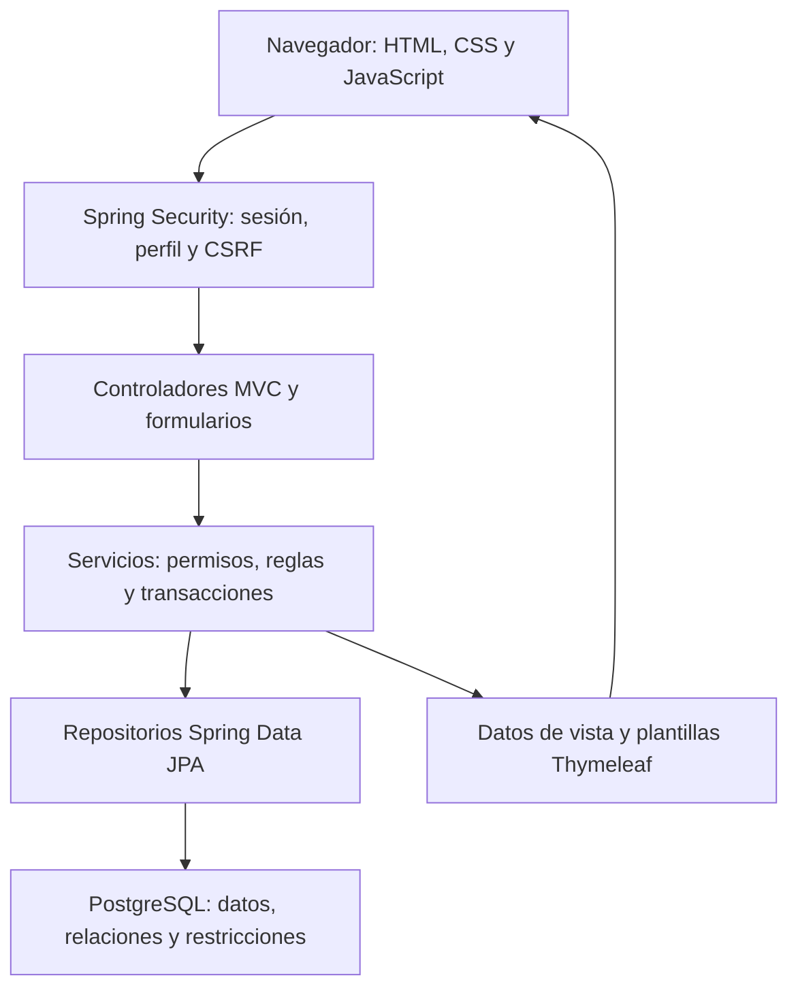
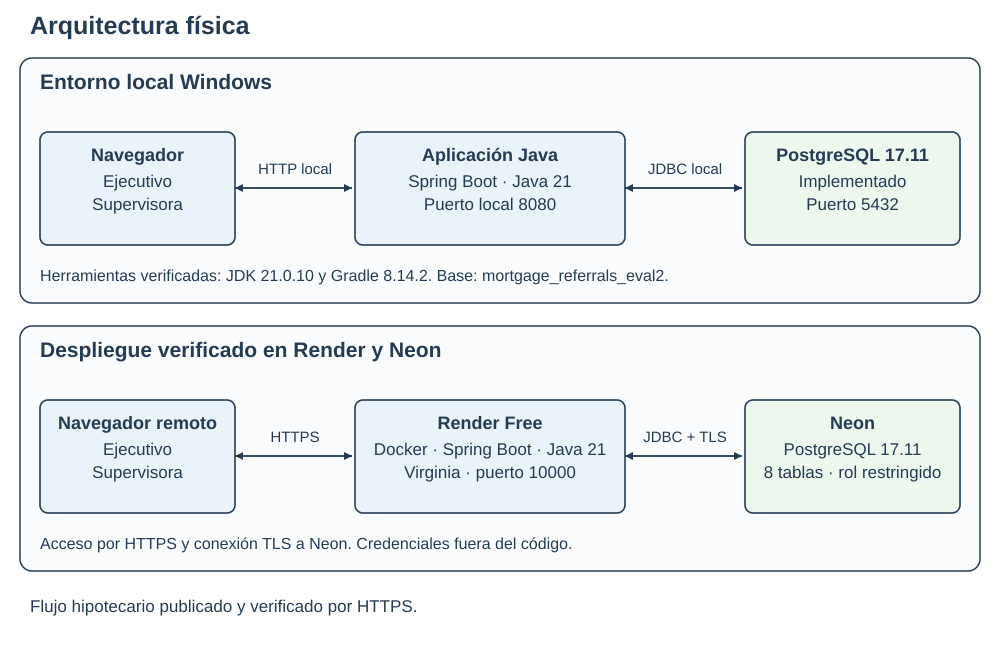

# Arquitectura del sistema

El sistema de derivación y seguimiento de consultas hipotecarias es una aplicación web monolítica organizada por capas. Spring Boot recibe las solicitudes, aplica las reglas de negocio y accede a PostgreSQL. Thymeleaf genera las páginas HTML y el navegador carga los estilos y las interacciones propias del proyecto.

La arquitectura cubre dos perfiles, las cuentas de usuario, los interesados, las derivaciones, la recepción, las gestiones, los estados y el historial. El resultado de una evaluación crediticia se registra como información externa; el sistema no evalúa ni aprueba créditos.

## Decisión y fundamento

Un monolito por capas permite mantener las operaciones del caso y de su historial en una transacción y desplegar una sola aplicación. Es una organización adecuada para el alcance de una oficina ficticia y el desarrollo individual. Las capas separan responsabilidades dentro del software; comparten el proceso Java.

| Alternativa | Aporte | Costo o limitación | Decisión |
|---|---|---|---|
| Monolito por capas con vistas del servidor | Un despliegue y una sesión; operaciones del caso y del historial dentro de la misma aplicación y base. | Las páginas se generan en el servidor y la aplicación se despliega como una unidad. | Seleccionado por su ajuste al flujo de formularios y a las reglas transaccionales. |
| Cliente SPA y API separada | Navegación dinámica y un contrato reutilizable por otros clientes. | Añade construcción del cliente y coordinación de validación y autenticación. | El alcance actual no requiere esa separación. |
| Microservicios | Despliegue independiente de componentes. | Añade comunicación entre servicios, configuración y coordinación de operaciones distribuidas. | Las operaciones relacionadas del dominio se mantienen en una unidad. |

## Estructura lógica



| Capa o componente | Responsabilidad | Tecnología y motivo |
|---|---|---|
| Presentación en el navegador | Mostrar bandejas, formularios, detalle e historial; presentar errores y permitir navegación por teclado. | HTML y CSS propio responsive. TypeScript aporta interacciones puntuales y se compila a JavaScript. |
| Adaptación web y vistas | Recibir solicitudes, validar campos, invocar servicios y devolver vistas o redirecciones. | Spring MVC y Thymeleaf, adecuados para formularios y navegación desde el mismo servidor. |
| Aplicación y negocio | Comprobar permisos sobre el caso, recibirlo, registrar gestiones y aplicar transiciones dentro de los límites transaccionales. | Servicios Java gestionados por Spring. Las reglas se aplican también ante una petición directa. |
| Persistencia | Consultar bandejas autorizadas y guardar cuentas, fichas, casos y actuaciones. | Spring Data JPA y JDBC de PostgreSQL. Los repositorios concentran consultas y bloqueos. |
| Datos | Conservar las relaciones, los catálogos, la autoría y la coherencia del estado y del historial. | PostgreSQL con claves, restricciones y funciones del esquema. |
| Seguridad transversal | Autenticar, mantener la sesión, comprobar el perfil y proteger las modificaciones. | Spring Security con BCrypt y CSRF, más la comprobación de pertenencia del caso en los servicios. |

La solicitud sigue el recorrido navegador → seguridad → controlador → servicio → repositorio → PostgreSQL. El servicio prepara los datos autorizados y Thymeleaf genera la respuesta. Las credenciales de la base permanecen en el servidor.

Los formularios utilizan objetos de entrada separados de las entidades persistentes. Las consultas de cuentas, bandeja y detalle preparan los datos de vista dentro de la transacción de lectura. Open Session in View está desactivado y las consultas cargan las relaciones necesarias antes de renderizar la página.

## Relación con el modelo y el diccionario de datos

El esquema tiene ocho tablas, 41 campos y 14 claves foráneas. JPA mapea siete entidades; el catálogo `status_transition` se consulta para ofrecer los cambios permitidos y participa en la validación de los pares de estados.

| Elementos del modelo | Uso en la aplicación |
|---|---|
| `role` y `user_account` | Autenticación, perfil, cuenta activa y administración de ejecutivos. |
| `lead` | Ficha del interesado reconocida por su RUT único y reutilizada entre derivaciones. |
| `referral` | Antecedentes del caso, responsables y estado vigente. |
| `status` y `status_transition` | Estados y catálogo de nueve transiciones admitidas. |
| `follow_up` | Gestiones con contenido, fecha y autor persistido. |
| `status_history` | Evento inicial, recepción y cambios de estado con su autoría y observaciones. |

El [modelo y diccionario](data-model.md) define los tipos, nulabilidad, claves, restricciones y relaciones que utiliza cada capa. La [normalización](normalization.md) explica su refinamiento y la conservación de la autoría de las actuaciones. Los nombres técnicos están en inglés y sus equivalencias se incluyen en el diccionario.

El esquema se instala mediante SQL y la aplicación lo valida al arrancar con `ddl-auto=validate`. La [migración 07](../database/07_feedback_integrity.sql) incorpora el catálogo de transiciones y las reglas de integridad que requiere la versión actual. El arranque no instala ni elimina tablas.

## Estructura física



### Entorno local

La aplicación se ejecuta como un proceso Java con JDK 21 y Gradle Wrapper 8.14.2. PostgreSQL 17 utiliza la base `mortgage_referrals_eval2` en `127.0.0.1:5432`. La configuración externa proporciona la URL JDBC y el usuario de aplicación. La [guía de PostgreSQL](postgresql-setup.md) y el [README](../README.md#ejecutar-la-aplicación-local) describen la preparación y el arranque.

### Servicio publicado

El navegador accede por HTTPS a [mortgage-referral-system.onrender.com](https://mortgage-referral-system.onrender.com). Render ejecuta el contenedor Docker con el perfil `prod` y PostgreSQL persiste en Neon, fuera del almacenamiento temporal del servicio web.

El contenedor escucha en el puerto asignado por Render. El proxy termina HTTPS y la aplicación reconoce los encabezados reenviados. El perfil publicado utiliza cookies de sesión seguras. `/login` es la ruta de comprobación de salud del servicio; la [guía de despliegue](deployment.md) explica su configuración.

La imagen se construye en etapas: Node.js compila TypeScript, un JDK empaqueta la aplicación y un JRE ejecuta el resultado con un usuario sin privilegios administrativos. Las credenciales se suministran fuera de la imagen.

El rol `mortgage_referrals_app` carece de privilegios administrativos. Los [permisos de aplicación](../database/05_application_permissions.sql) permiten consultar los catálogos y consultar e insertar gestiones e historial. Las cuentas administrativas se reservan para instalar el esquema. La conexión Java a Neon utiliza TLS con `verify-full`, validación del nombre del servidor, el almacén de confianza del JRE y channel binding obligatorio.

## Tecnologías seleccionadas

| Componente | Selección y aporte | Consideración |
|---|---|---|
| Lenguaje | Java 21, con objetos y servicios para las reglas del dominio. | Mantiene una sola plataforma del servidor. |
| Framework | Spring Boot 4.1.2, con integración de MVC, seguridad y persistencia. | Sus convenciones simplifican la configuración y requieren comprender su ciclo de solicitudes. |
| Vistas | Thymeleaf, HTML, CSS propio y JavaScript compilado desde TypeScript 5.9.3. | Las acciones principales pueden requerir recarga o redirección. |
| Persistencia | Spring Data JPA y JDBC. | Los repositorios y las consultas deben controlar la carga de relaciones y la paginación. |
| SGBD | PostgreSQL 17.x, verificado con 17.11. | Las relaciones del dominio y las operaciones transaccionales se respaldan en la base. |
| Acceso | Spring Security con formulario y sesión del servidor. | La sesión se mantiene en memoria de la instancia. |
| Construcción | Gradle Wrapper 8.14.2 y Node.js 22. | La compilación TypeScript se integra en el empaquetado Java y en Docker. |

Las versiones de las bibliotecas de Spring se gestionan mediante las dependencias de Spring Boot. TypeScript está fijado en los archivos de construcción y la interfaz utiliza CSS propio.

## Permisos y controles del dominio

| Operación | Control aplicado |
|---|---|
| Iniciar sesión, salir y editar perfil | Cuenta activa, correo y BCrypt; cambio de contraseña con comprobación de la actual; cierre que invalida la sesión. |
| Administrar ejecutivos | Perfil de supervisora verificado en las rutas y el servicio. El servidor asigna el rol ejecutivo al crear la cuenta. |
| Registrar o recuperar interesado | RUT validado en Java; formato, unicidad y contacto obligatorio respaldados en PostgreSQL. Recuperar una ficha no concede acceso a derivaciones ajenas. |
| Crear o corregir derivación | Creador obtenido de la sesión y supervisora activa asignada. Solo el creador puede corregir antes de la recepción. |
| Consultar bandeja y detalle | Consultas limitadas al ejecutivo creador o a la supervisora destinataria, con comprobación adicional al acceder por identificador. |
| Recibir o cambiar estado | Perfil, pertenencia, estado actual y transición permitida comprobados dentro de una transacción. El cierre exige observación. |
| Registrar gestión | Supervisora asignada, caso recibido y abierto, contenido válido y autor obtenido de la sesión. Una gestión no modifica el estado. |

Las peticiones protegidas comprueban la cuenta activa, el perfil y la vigencia de las credenciales. Las sesiones se asocian al identificador estable de la cuenta y se invalidan cuando cambia el correo o la contraseña. Las modificaciones de cuenta bloquean su fila y PostgreSQL aplica la unicidad del correo.

La cuenta supervisora inicial se provisiona únicamente cuando no existe ninguna, utilizando la configuración externa. Las contraseñas se guardan con BCrypt. Las cookies son `HttpOnly` y `SameSite=Lax`, y en el perfil publicado también `Secure`. CSRF protege los formularios. Los datos de vista excluyen hashes y los errores no muestran detalles de conexión.

## Transacciones y concurrencia

La creación de una derivación y su evento inicial comparten una transacción. El evento inicial tiene estado previo nulo y guarda al ejecutivo autenticado. Al finalizar la transacción, PostgreSQL comprueba que exista ese evento y que el estado vigente coincida con el último evento del historial.

La recepción, la corrección, el registro de gestiones y los cambios de estado bloquean la derivación antes de modificarla. El cambio de estado compara el estado enviado con el vigente, valida el catálogo e inserta un evento con el autor de la sesión. PostgreSQL valida su continuidad y sincroniza `current_status_id`.

El bloqueo por caso coordina una gestión con un posible cierre concurrente. Una gestión y un cambio de estado siguen siendo operaciones independientes. Las actuaciones existentes están protegidas frente a modificaciones o eliminaciones desde el rol de aplicación.

## Organización del código

```text
cl.rodrigobarrera.mortgagereferrals
  config       Configuración, seguridad y provisión inicial
  web          Controladores, formularios y datos de vista
  service      Usuarios, interesados, derivaciones y seguimiento
  model        Entidades persistentes
  repository   Consultas y acceso mediante JPA

src/main/resources
  templates    Pantallas Thymeleaf y fragmentos comunes
  static/css   Estilos responsive
  static/js    JavaScript generado durante la construcción

frontend       Fuentes TypeScript
database       Esquema, catálogos, permisos y migración
docs           Modelo de datos, arquitectura e instrucciones
```

La dirección principal de uso es `web` → `service` → `repository`. El servicio devuelve datos preparados para la vista y las entidades representan las relaciones de la base.

## Mantenimiento y límites

Las bandejas filtran y paginan en PostgreSQL. Los índices apoyan las consultas por responsable y estado. Hikari admite hasta cuatro conexiones en local y dos en `prod`; el perfil publicado limita Tomcat a 20 hilos. Las mediciones de carga y de consumo sostenido requieren una evaluación específica.

La instancia conserva las sesiones en memoria. Un reinicio puede exigir volver a iniciar sesión, mientras que los datos permanecen en Neon. Una ampliación a varias instancias requeriría revisar la gestión compartida de sesiones y el despliegue.

El [plan de pruebas y resultados](test-plan.md) relaciona los casos de acceso, permisos, flujo hipotecario, persistencia e interfaz con sus entornos de comprobación.

## Referencias técnicas

- [Spring MVC y Thymeleaf](https://spring.io/guides/gs/serving-web-content/).
- [Spring Boot y bases de datos SQL](https://docs.spring.io/spring-boot/reference/data/sql.html).
- [Spring Security y autenticación por formulario](https://docs.spring.io/spring-security/reference/servlet/authentication/passwords/form.html).
- [Spring Security y CSRF](https://docs.spring.io/spring-security/reference/servlet/exploits/csrf.html).
- [Spring Data JPA y bloqueos](https://docs.spring.io/spring-data/jpa/reference/jpa/locking.html).
- [Spring Framework y transacciones declarativas](https://docs.spring.io/spring-framework/reference/data-access/transaction/declarative/annotations.html).
